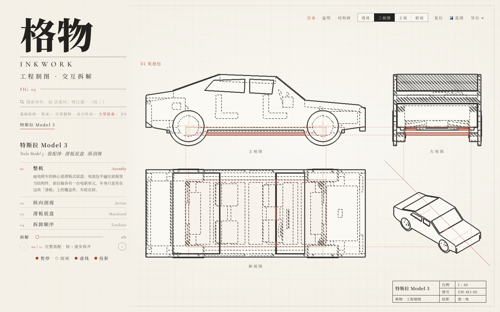
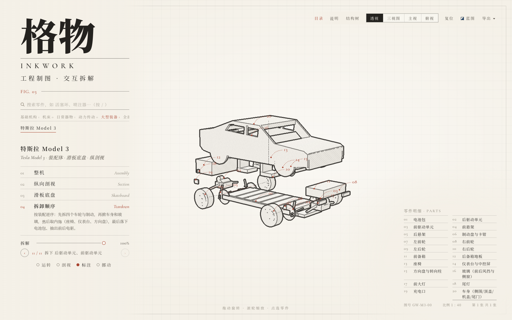
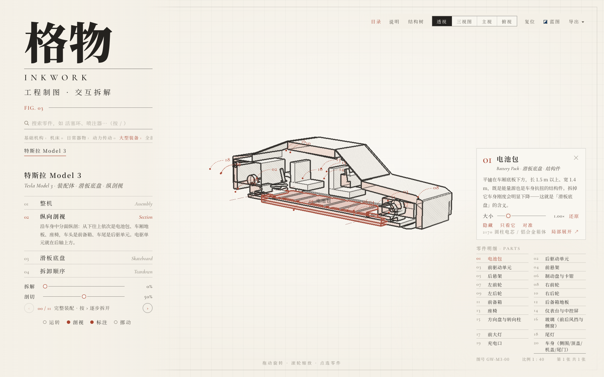
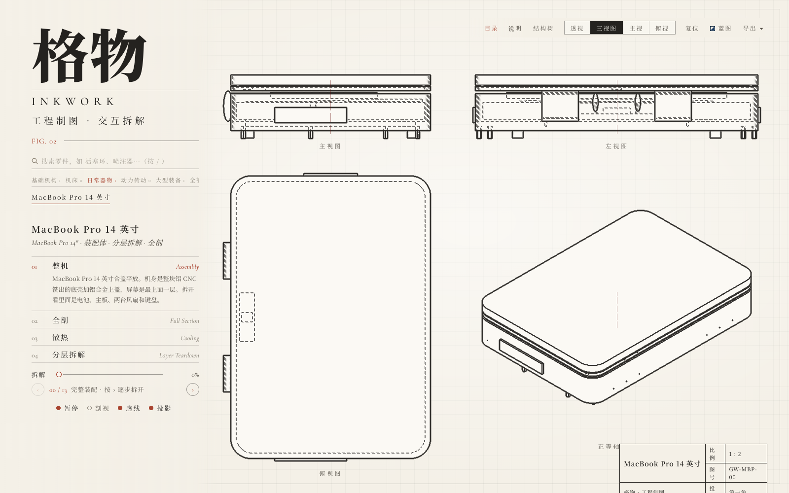

# 格物 · Inkwork 机械制图技能

**一句话：对 AI 说"画一台 XX 的机械图"，它就用真实 3D 几何给你出一套工程图——透视轴测图版、第一角三视图、剖视图、爆炸拆解图，还带联动动画。**



一个可安装的 **Agent Skill（技能）**，配套一个完整可跑的线稿渲染引擎。
引擎负责"把几何变成工程图"，技能负责"告诉 agent 怎么把机器建成几何"。

---

## 能出什么

| 透视轴测图版 | 全剖 / 纵剖视图 | 爆炸拆解图 | 第一角三视图 |
|---|---|---|---|
| 线稿 + 铅笔排线 | 45° 剖面线、相邻零件方向相反 | 分层拆解、编号气泡引线 | 长对正/高平齐/宽相等 + 虚线 + 点画线 + 标题栏 |







其他能力：

- **两种配色**：纸面线稿 / 工程蓝图（cyanotype）
- **交互**：拖动旋转、滚轮缩放、点选零件、隐藏 / 只看它 / 对准、结构树、全局搜索
- **导出**：A4/300dpi 图版 PNG（带编号气泡、明细表、标题栏）、拆装动画 WebM
- **分享**：地址栏跟着当前机器和选中零件变（`#model3/battery`）

---

## 快速开始

### 方式一：直接用这个仓库（最快）

```bash
git clone https://github.com/orionsheep/inkwork-mechanical-drawing.git
cd inkwork-mechanical-drawing
npm install
npm run dev        # 打开 http://localhost:5173
```

仓库里自带 `.claude/skills/mechanical-drawing/`，**用 Claude Code 打开这个目录，技能会被自动发现**，直接说
「画一台齿轮泵的机械制图」就行。

### 方式二：把技能装到全局，任意目录可用

```bash
git clone https://github.com/orionsheep/inkwork-mechanical-drawing.git
cd inkwork-mechanical-drawing
./install.sh              # 装到 ~/.claude/skills/
./install.sh --codex      # 同时装到 ~/.codex/skills/（Codex）
```

然后新建一个工程：

```bash
node ~/.claude/skills/mechanical-drawing/create-project.mjs ./my-drawing
cd my-drawing && npm install && npm run dev
```

在 `my-drawing` 里对 agent 说：

> 画一台**行星齿轮减速器**的机械制图，能拆解、要剖视、出三视图

### 方式三：在已有工程里加一台机器

```bash
node .claude/skills/mechanical-drawing/make-machine.mjs gearpump "齿轮泵" "Gear Pump"
```

会生成 `src/machines/gearpump/` 骨架（能直接跑），然后照技能里的流程填零件表和几何。

---

## 技能是怎么工作的

技能只有一条主线，**你只写三样东西**：

```
PARTS 零件表  +  几何（kit 积木）  +  MachineDef（镜头/步骤/轴线）
                        │
                        ▼
        引擎自动产出：线稿 / 剖视 / 三视图 / 爆炸图
```

关键认知：**引擎不画 2D 线**。它摆真实的 3D 几何，再从**法线 / 深度 / 零件 ID 的不连续处**
自动"提炼"出线。所以——

> **几何摆对了，图就对了。**

- 想要「装配图每个零件轮廓分明」→ 把零件分对（`<Part id>`）
- 想要「剖视里能看到内部」→ 把内部结构真的建出来，并摆在 z=0 对称面上
- 想要「三视图自动长对正」→ 模型坐标摆正（+x 前、+y 上、地面 y=0）

完整原理：**[docs/GUIDE.md](docs/GUIDE.md)**；给 agent 的精简版：
[`.claude/skills/mechanical-drawing/reference.md`](.claude/skills/mechanical-drawing/reference.md)。

---

## 自带三台范例

| 机器 | 零件 | 学什么 |
|---|---|---|
| **弹性柱销联轴器** `coupling` | 7 | 最小完整例子：会转、可全剖、回转体车削 |
| **MacBook Pro 14"** `macbook` | 16 | 超薄分层堆叠体：分层拆解、厚度放大技巧 |
| **特斯拉 Model 3** `model3` | 20 | 侧视轮廓拉伸的复杂装配：滑板底盘、纵剖视 |

```bash
npm run dev
# 顶栏「目录」可切换，或直接用 hash：
#   http://localhost:5173/#coupling
#   http://localhost:5173/#macbook
#   http://localhost:5173/#model3
```

---

## 目录结构

```
├── .claude/skills/mechanical-drawing/   ← 技能本体
│   ├── SKILL.md            主流程（定题→零件表→几何→联动→子组件→验收）
│   ├── reference.md        渲染原理精简版
│   ├── make-machine.mjs    新机器脚手架
│   ├── create-project.mjs  新工程脚手架
│   └── template.tsx        最小骨架
├── docs/
│   ├── GUIDE.md            核心原理（轮廓提取/剖视/三视图/深度剥离）
│   └── screenshots/
├── src/
│   ├── scene/              渲染核心：ink.ts（着色器）、InkRenderer、Part、geometry
│   ├── drawing/            三视图排版（第一角）与 SVG 图层
│   └── machines/           kit.tsx 建模积木 + types.ts + 三台范例
├── scripts/                自检、缩略图、字体子集
└── install.sh
```

## 常用命令

```bash
npm run dev            # 开发服务器
npm run build          # 生产构建（含 tsc 类型检查）
npm test               # 运动学单元测试
npm run check          # 无头浏览器逐台自检（0 报错才算过）
npm run thumbs         # 重新生成目录缩略图
```

> 自检/缩略图脚本需要 Chromium 内核浏览器（Edge / Chrome），可用 `GEWU_BROWSER=/路径/浏览器` 指定。

---

## 许可与致谢

- 本仓库的渲染引擎派生自 **[G1en-114/gewu](https://github.com/G1en-114/gewu)**（原作者的开源项目），
  在此基础上裁剪为可复用技能、补充了 `macbook` / `model3` 两台范例、跨平台自检与本文档。
  详见 [NOTICE.md](NOTICE.md)。
- 代码以 [MIT](LICENSE) 发布。
- 所有机器尺寸均取自**公开规格 / 公开拆解资料**，仅作教学示意；不含任何厂商商标或标志。
